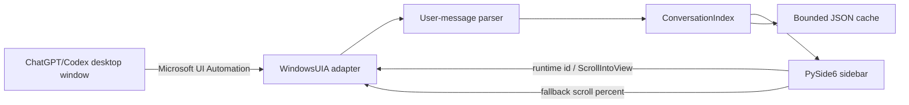

# Architecture

## Data flow

## Components

- `windows_uia.py`：发现主窗口、定位对话滚动容器、扫描用户消息并执行跳转。
- `parser.py`：根据实测 `You said:` / `ChatGPT said:` 语义标记区分角色、规范化文本和去重。
- `cache.py`：原子写入 JSON，维护轻量目录，并按数量、容量和保存时间清理。
- `app.py`：PySide6 界面、后台线程、托盘、全局快捷键、滚动事件即时采样、尾随对话确认和虚拟桌面隔离。
- `diagnose_accessibility.py`：独立生成 UI Automation 树，供应用升级后重新调查。

## Privacy model

运行时没有网络客户端。所有正文只来自系统无障碍接口，并存储在本机 `data/indexes`。日志只记录消息哈希、长度和错误。公开提交必须排除诊断树、截图、日志和索引。

## Performance model

- 启动或手动点击时仅贴靠一次，不周期性改写目标窗口几何。
- 主窗口句柄及滚动容器 class 缓存；重建复用容器，只稳定采样直接子节点并对用户消息正文解析一次。
- 点击跳转优先按 runtime id 直接定位。
- UIA 扫描与跳转在后台线程执行。
- 滚动中以最高约 10 Hz 即时采样，快照只追加新问题；缓存仅在索引变化后合并到 1.5 秒静默期写入，避免高频磁盘写入和覆盖重建刻度。
- `CREATE` / `SHOW` / `REORDER` 驱动即时采样，忽略 ChatGPT 空闲时持续出现的名称抖动；60 秒低频身份确认同时检查 PID，应用重启后自动重绑 WinEvent 监听。
- 完整扫描和跳转期间屏蔽自身滚动事件；失败请求采用指数退避并清空积压队列，完整重建只能由用户明确触发。
- 用户标记与正文气泡之间允许任意数量的附件节点，解析器持续查找到下一条语义消息标记。
- 缓存缺失时创建 `is_complete=false` 的可见区临时索引，自然滚动只做增量追加；完整扫描是显式用户操作。
- 当前对话只在内存中保留一份，完整 tooltip 按需解析。
