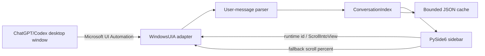

# Architecture

## Data flow

## Components

- `windows_uia.py`：发现主窗口、定位对话滚动容器、扫描用户消息并执行跳转。
- `parser.py`：根据实测 `You said:` / `ChatGPT said:` 语义标记区分角色、规范化文本和去重。
- `cache.py`：原子写入 JSON，维护轻量目录，并按数量、容量和保存时间清理。
- `app.py`：PySide6 界面、后台线程、托盘、全局快捷键、事件防抖和虚拟桌面隔离。
- `diagnose_accessibility.py`：独立生成 UI Automation 树，供应用升级后重新调查。

## Privacy model

运行时没有网络客户端。所有正文只来自系统无障碍接口，并存储在本机 `data/indexes`。日志只记录消息哈希、长度和错误。公开提交必须排除诊断树、截图、日志和索引。

## Performance model

- 启动或手动点击时仅贴靠一次，不周期性改写目标窗口几何。
- 主窗口句柄缓存，消息扫描只构建用户消息气泡节点。
- 点击跳转优先按 runtime id 直接定位。
- UIA 扫描与跳转在后台线程执行。
- 当前对话只在内存中保留一份，完整 tooltip 按需解析。
